# Plane Radar: CYD edition

A port of [MatixYo/ESP32-Plane-Radar](https://github.com/MatixYo/ESP32-Plane-Radar) to the
**ESP32-2432S028R "Cheap Yellow Display"** (2.8" 320x240 touchscreen). It keeps what made the
original good (live ADS-B from adsb.fi on a sonar-style radar, phone-based Wi-Fi setup, the
same colours, rules and BOOT-button controls) and uses the bigger touchscreen for a lot more.

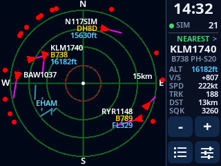 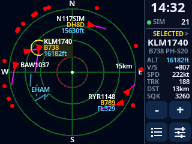

## What's new compared with the original

| Area | Original (1.28" round) | CYD edition |
|------|------------------------|-------------|
| Screen | 240x240 radar | 240x240 radar + info panel (clock, feed status, aircraft count, nearest/selected aircraft card) |
| Input | BOOT button | Touch (tap aircraft, zoom +/-, list, settings) **and** the same BOOT controls |
| Ranges | 5/10/15/25 km | 2/5/10/15/25/40/60 km |
| Labels | Always full | Full / callsign / off, with **automatic decluttering** so tags never overlap |
| Text | One font, scaled | Crisp hinted fonts rendered at each native size (11/13/15/22/32 px) |
| Aircraft | Tag on the radar | Tap the card for a detail page: full data, a mini plot and a **closest-approach prediction** ("Overhead in 1:04 at 7,500 ft") |
| Night | | **Night mode**: dims the screen and switches to the red theme on a schedule |
| Extras | | Flight trails, colour-by-altitude, sweep animation, 4 themes (Classic, Amber CRT, Ice, Night red), emergency squawk highlight, proximity alert (ring + RGB LED), traffic list sortable by distance/altitude/callsign, 180 degree rotation, metres / km/h / mph / nm units, altitude filter |
| Setup portal | WiFiManager default look | Restyled dark portal, **QR codes on screen** to join the setup Wi-Fi and open the page, extra pages: Radar settings, Airports, Live traffic |
| Airports | 1,166 built-in large airports | Same built-in set **plus your own airports**, found by name, city, ICAO or IATA from an offline list of 6,029 airports, on the touchscreen or the web page (see below) |
| Updates | USB only | USB, or over Wi-Fi from the portal's Update page |

## Finding and adding airports

Custom airports are drawn in violet and override the built-in ones. Up to 24 are stored.

- **On the touchscreen:** Settings > *Find airport* (or Airports > **FIND**). Type a name, city
  or code: `TAMPA`, `KTPA` and `TPA` all find Tampa Intl; several words narrow it down
  (`ST PETE`, `NEW YORK`). Results update as you type and are sorted by match, then distance;
  with nothing typed the list shows the airports nearest the radar. Tap a result to fetch its
  runways, check the preview, then:
  - **SAVE** adds it to the radar,
  - **HOME** adds it *and* moves the radar centre there (works offline too, just without
    runways).
  Codes that are not in the list (small strips such as `00AK`) get a *Look up online* row.
- **On the web page** (`http://plane-radar.local/airports`): the same search with live results;
  *Add & centre here* does what HOME does. You can also enter a strip manually (centre + heading +
  length, or the two runway ends) and export/import the list as JSON.

The search list (6,029 large and medium airports plus small ones with airline service, from
OurAirports) is built into the firmware, so it needs no connection. Regenerate it with
`python scripts/build_airport_index.py`.

How the lookup works: OurAirports' `airports.csv` (12.7 MB) and `runways.csv` (4 MB) are sorted
by ident, so the radar binary-searches them with small HTTP Range requests (about 26 requests,
a few seconds) instead of downloading them. That covers every airport and airfield in the
database, including small strips. Where a runway has no surveyed ends, it is drawn from the
airport position, heading and length (parallel L/R runways are offset).

## Hardware

Any ESP32-2432S028R. Nothing to wire: the display, touch, RGB LED and BOOT button are on the
board.

Two panel variants exist. Pick the matching build:

| Board | Build env / image |
|-------|-------------------|
| Original CYD, one micro-USB, ILI9341 | `cyd` / `plane-radar-cyd-ili9341.bin` |
| "CYD2USB", micro-USB + USB-C, ST7789 | `cyd2usb` / `plane-radar-cyd2usb-st7789.bin` |

If the colours look like a photo negative, turn on *Invert colours* (Settings > System, or the
web settings page). Serial command `panel` prints the panel ID if you are unsure.

## Flashing

**Ready-made image:** `release/plane-radar-cyd-ili9341.bin` (or the CYD2USB one). Flash it at
address **0x0** with [ESP Web Tools / esptool-js](https://espressif.github.io/esptool-js/) in Chrome/Edge.
This full image also clears the stored Wi-Fi and settings (it covers the settings area), so use it
for a first install. To **update** without losing them, open *Firmware update* in the web pages
(log in first) and upload `release/plane-radar-cyd-ili9341-update.bin` (or the CYD2USB
`-update.bin`). The screen shows "UPDATING", then the radar restarts. A wrong or damaged file is
rejected and the old firmware keeps running. From source: `pio run -e cyd -t upload` (app only).

**From source** (PlatformIO):

```bash
pio run -e cyd -t upload
```

If upload stops at `Connecting....` with "Wrong boot mode", hold the **BOOT** button on the
board while it connects (some CYD boards' auto-reset cannot pull IO0 low).

## First-time setup

1. Power on. The first boot asks you to **tap 4 arrow tips** to calibrate the touchscreen
   (once; hold a finger on the screen during boot to redo it).
2. The screen turns yellow and shows two QR codes. Scan **JOIN WI-FI** with your phone (or join
   `PlaneRadar-Setup` with the 8-character **password** shown under it), then scan **OPEN PAGE**
   (or open `http://192.168.4.1`). The page often opens by itself.
3. Tap *Wi-Fi & home airport*, pick your network and enter its password, then type your home
   airport (name, city or code, e.g. "Tampa" or "KTPA") and pick it from the list. The radar
   centres on that airport. Choose the distance units and tap *Save*.
4. The radar connects and starts showing traffic. Everything else can be changed later at
   `http://plane-radar.local` (or the IP shown under Settings > Device info, with a QR code).
   The web pages share one layout: **Home**, **Radar** (home airport and all settings),
   **Airports** (search, your list, private strips, backup) and **Live**.

## Password and web login

Each board makes its own random 8-character code on first boot and keeps it (it survives Wi-Fi
resets and firmware updates; only a full erase or the merged image makes a new one).

- It is the password of the `PlaneRadar-Setup` Wi-Fi, shown on the yellow setup screen.
- On your home network every web page, including Wi-Fi, firmware update and restart, asks for a
  login: user **admin**, password = the same code. Find it any time on the CYD under
  Settings > **Device info** (row WEB LOGIN), or type `code` in the serial monitor.
- A login lasts while you keep using the pages (30 minutes idle) for that phone or computer.

## Controls

| Where | Action | Effect |
|-------|--------|--------|
| Radar | Tap an aircraft | Select it: highlighted, full tag, longer speed vector, details in the panel |
| Radar | Tap empty space | Deselect (panel shows the nearest aircraft) |
| Panel | Tap the aircraft card | Detail page with closest-approach prediction (tap to close) |
| Radar | Long-press | Cycle label mode (full, callsign, off) |
| Panel | `-` / `+` | Zoom out / in |
| Panel | List icon | Traffic list (tap the header button to sort, drag to scroll, tap a row to select) |
| Panel | Sliders icon | Settings (4 pages; swipe or use `<` `>`) |
| BOOT button | Short tap | Cycle range (as the original) |
| BOOT button | Hold 3 s | Clear Wi-Fi, location and settings; reboot into setup (as the original; touch calibration and custom airports are kept) |

**Status LED:** short green blink on each data update, red flashing during a proximity alert,
amber blink every 3 s when offline. Can be turned off.

## Screens

| | | |
|---|---|---|
| 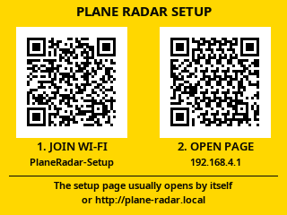 | 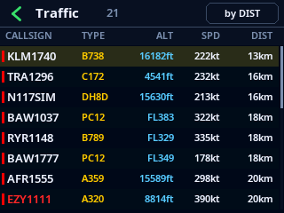 | 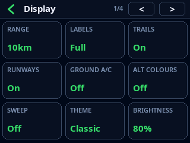 |
| Setup with QR codes | Traffic list | Settings |
| 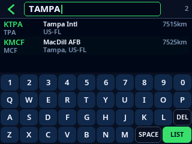 | 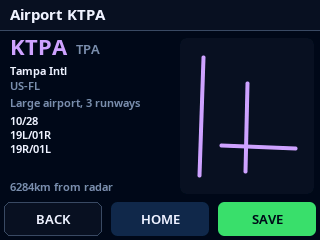 | 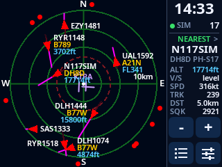 |
| Search "TAMPA" | Result: SAVE or HOME | Radar moved to KTPA |
| 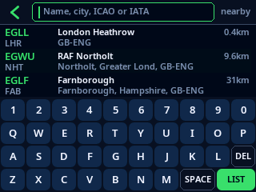 | 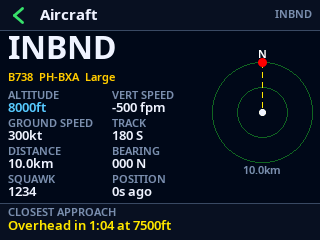 | 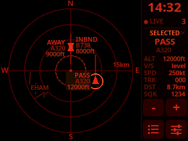 |
| Nearby airports (empty search) | Aircraft detail + closest approach | Night mode |
| 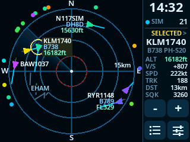 | 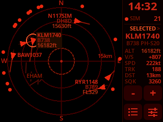 | 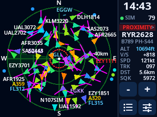 |
| Ice theme, altitude colours, sweep | Night theme | 80 aircraft, labels decluttered |

## Testing

### Host simulator (no hardware)

`sim/` compiles the real UI, settings, traffic, airport store and airport lookup code for
Windows (MSVC) against LovyanGFX's sprite renderer and small Arduino stubs. It drives the UI
with injected taps, writes PNG screenshots and checks:

- **Placement accuracy**: aircraft at known offsets (N/E/S/W/diagonals, 0.2 to 12 km) against
  an independent WGS84 local-plane reference. Worst error 0.78 px.
- **Range scaling** for every preset and rim-dot bearings beyond the ring.
- **Runway overlay**: EHAM 36L threshold within 0.81 px of its OurAirports coordinates.
- **Airport lookup**: EGLL, KJFK, EHAM, LFPG, 00AK (synthesised runway), a heliport and a
  missing ident, through the same Range-request binary search (served from local CSV copies).
- **Airport search**: 16 queries by name, city, ICAO and IATA (`tampa`, `TPA`, `st pete`,
  `new york`, `CDG`...) land on the right airport; nearby list; about 0.3 ms per search on a PC.
- **Touch flow**: Menu > Airports > FIND > type > lookup > SAVE, then search "TAMPA" > HOME
  (radar centred on KTPA with runways), the "look up online" row, and HOME while offline.
- **Closest approach**: inbound overhead (0 km in 64.8 s, altitude extrapolated), abeam pass
  (8 km E in 38.9 s) and a departing aircraft.
- **Night mode** windows (same-day and across midnight) and **settings migration** from the
  previous firmware (location and settings kept).
- **Stress**: 80 aircraft, 10 simulated minutes, sweep + trails + altitude colours + alert ring,
  cycling every range. 3,000 frames, no failures. 68 checks in total.

```bat
pio run -e cyd
mkdir sim\sim_data
curl -o sim\sim_data\airports.csv https://raw.githubusercontent.com/davidmegginson/ourairports-data/main/airports.csv
curl -o sim\sim_data\runways.csv https://raw.githubusercontent.com/davidmegginson/ourairports-data/main/runways.csv
sim\build.bat
cd sim && mkdir sim_out sim_fs && plane_radar_sim.exe sim_out
```

### On the device

With the board connected (and flashed):

```bash
python tools/device_test.py COM4
```

It screenshots every screen over USB (`tools/screenshot.py`, frame buffer streamed at 921600
baud), then runs 80 simulated aircraft for 60 s and reports frame time and minimum free heap.
Type `help` in a serial monitor (115200) for the test commands (`sim N`, `tap X Y`, `shot`,
`screen NAME`, `lookup ICAO`, `stats`, `panel` ...). *Demo traffic* in Settings > System runs
the same simulation without a computer.

### Portal preview

`python tools/portal_preview.py` serves the real portal pages with a mock API at
`http://localhost:8080` to check the web UI without hardware.

## Project layout

```
include/ src/
  config.h                  pins, timing, defaults
  hardware/                 LovyanGFX device (ILI9341/ST7789 + XPT2046), backlight, LED, font
  services/
    settings                all user settings (one NVS blob) + unit formatting
    adsb_client             adsb.fi fetch, streamed element-by-element, keeps the 80 nearest; simulator
    airport_store           custom airports in LittleFS (/airports.json)
    airport_lookup          on-device OurAirports lookup (HTTP Range binary search)
    airport_search          offline search by name / city / ICAO / IATA over the built-in list
    wifi_setup              WiFiManager flow and BOOT button (from the original)
    web_portal, web_pages.h restyled portal + /settings /airports /live + JSON API
  ui/
    canvas                  banded full-frame renderer (no PSRAM needed), serial screenshots
    traffic                 projection, dead reckoning, trails, alerts, runway overlay cache
    radar_view              radar + info panel, tag decluttering
    screens                 list, settings, airports, lookup, info, confirm
    search_screen           airport search keyboard + live results
    detail_screen           aircraft detail + closest approach
    status_screens          boot, connecting, setup (QR), errors
  data/large_airports       built-in runway set (from the original; scripts/build_large_airports.py)
  data/airport_index        6,029-airport search list (scripts/build_airport_index.py)
data/font_*.vlw             UI fonts per size (scripts/build_fonts.py, sources in fonts_src/)
sim/                        host simulator + test runner
tools/                      screenshot, device test, portal preview, serial helpers
release/                    full images (flash at 0x0) and -update.bin files (web update)
```

## Notes

- The CYD has no PSRAM, so frames are drawn in 320x48 bands into a 30 KB sprite and pushed;
  this gives flicker-free full-frame updates. The radar redraws every 200 ms (80 ms with the
  sweep animation); actual frame time on the board is printed every 50 frames on serial.
- The ADS-B response is parsed one aircraft at a time, so memory use does not grow with
  traffic; at large ranges the 80 nearest aircraft are kept.
- adsb.fi's public limit is 1 request/s; the default poll is every 5 s (3 to 30 s selectable).
- Time zone for the clock is set on the web settings page (auto-suggested from your browser).
  Night mode uses it, and starts once the clock has synced.
- Fonts are generated by `scripts/build_fonts.py` (Noto Sans, hinted, one file per size).
- Flash use is about 91% of the OTA app slot (the airport search list is ~330 KB).
